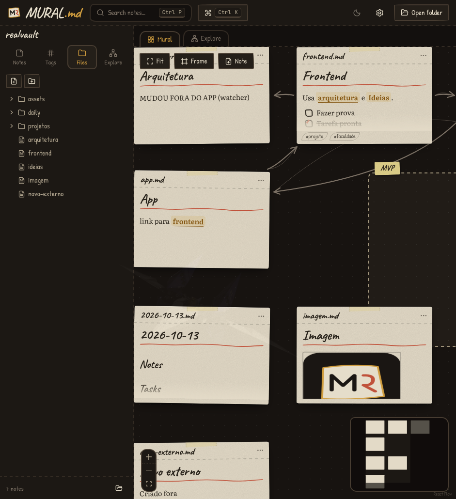
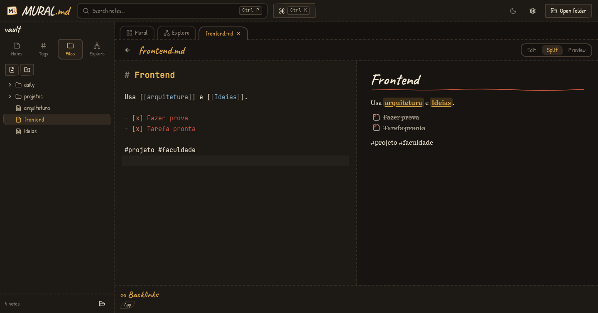
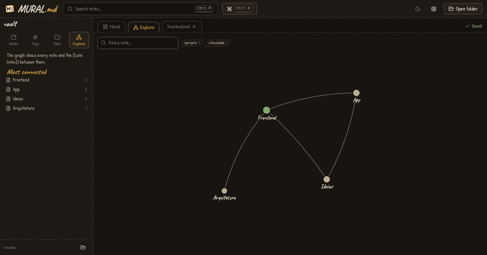
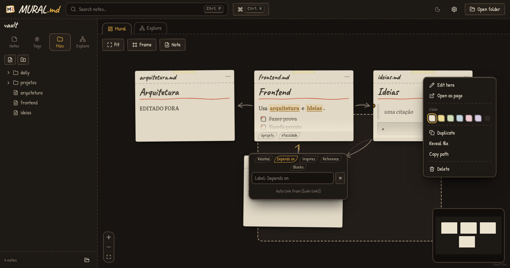

# b&m notes

**A local-first spatial Markdown workspace.**

> Your notes are just files.

Pick a folder of `.md` files and b&m notes spreads them out as cards on an infinite, hand-drawn wall.
No account, no cloud, no lock-in — everything is plain Markdown on your disk.



## Highlights

- **No account, no cloud, no lock-in** — it never touches the network.
- **Plain Markdown** — the `.md` files are the single source of truth. Edit them in VS Code or Obsidian at the same time.
- **Infinite canvas** — pan, zoom, minimap, multi-select, resizable cards, dashed frames, hand-drawn links.
- **Wiki links** (`[[note]]`, `[[folder/note|alias]]`) become sketchy arrows between cards, with optional labels.
- **Backlinks**, **tags** (`#idea`), **daily notes**, **interactive checkboxes** that edit the real file.
- **Local search** across file names, titles, tags and content (Ctrl+P), plus a **command palette** (Ctrl+K).
- **Graph view** of every note and link.
- **Smart rename**: renaming or moving a note shows how many `[[links]]` in other notes would break and offers to update them.
- **Trash**: deleting moves notes to `.mural/trash/`; restore them or empty the trash from the sidebar. Retention is configurable (default 30 days).
- **Light and dark** themes, plus optional **GitHub sync** for sharing a folder.
- Paste or drop images: they are copied to `assets/` and referenced as normal Markdown.

| Note page | Graph | Card menu |
|---|---|---|
|  |  |  |

## Stack

React 19 · TypeScript (strict) · Vite · Tailwind CSS v4 · Zustand · XYFlow / React Flow (canvas) · CodeMirror 6 (editor) ·
unified/remark/rehype + highlight.js (preview) · Tauri 2 · Rust (`notify` for the watcher).

## Your data

```
MyVault/
  ideas.md
  projects/app.md
  assets/            <- pasted / dropped images
  daily/2026-10-13.md
  .mural/            <- the ONLY buturenotes-specific data
    board.json       <- card positions, sizes, colors, frames, manual links, viewport
    settings.json    <- workspace preferences
    backups/         <- a few snapshots of board.json
```

- Visual information is **never** written into your Markdown.
- `.mural/` is created lazily, only when there is something to save.
- Deleting `.mural/` loses layout only; your notes are untouched.
- If `board.json` is corrupted, buturenotes keeps the broken file as `board.corrupt.json`, restores the newest valid
  backup (or lays the board out again) and never touches a `.md`.

## Privacy & safety

- Fully offline by default: no telemetry, strict CSP. The only network use is the optional GitHub sync below, which you turn on yourself.
- Every filesystem command validates paths against the opened workspace (no `..`, no absolute paths, no
  symlink escapes), writes are atomic (temp file + rename), and deleting always asks first.
- External edits are picked up live by the watcher. If a note has unsaved local edits when the file changes on
  disk, you get a banner to keep yours or load the disk version.

## Sync with GitHub (optional)

Off by default: without it the app makes no network calls. To share a folder with a friend:

1. **Settings → Sync → Connect to GitHub.** Your browser opens GitHub; paste the short code shown in the app. The token is kept in the app's config folder (permissions `0600`), never inside your notes.
2. **Pick a repository:** create a new one (private by default), choose an existing one, or paste `owner/name`. Your friend does the same with the same repository (they need write access).
3. From then on the app commits your changes ~15 s after you stop typing, checks for new changes every 45 s, and pushes. The cloud icon in the header shows the state; click it to sync now.

How conflicts are handled:

- Different notes, or different lines of the same note, merge automatically (it is plain `git`).
- If you both changed the same lines, the note shows up under **Settings → Sync → Changed on both sides**: *Keep mine*, *Keep theirs*, or *Keep both* (the other version is saved as `note (from other).md`). Nothing is lost.
- `.mural/board.json` merges per card, so moving different cards never conflicts; the viewport is local.
- `.mural/settings.json`, backups and `sync.json` are never uploaded (added to `.gitignore`).

Requirements: `git` installed. Unlinking (Settings → Sync) stops syncing and deletes nothing. Large files (> 10 MB) trigger a warning because they make the repository heavy.

## Install / run from source

There are no published binaries yet: you build buturenotes yourself (about 3-5 minutes the first time).
Everything below needs **Node 20+**, **Rust (stable)** and the system WebView libraries for your OS.

```bash
git clone https://github.com/pedrobuture-ship-it/buturenotes.git
cd buturenotes
npm install
npm run tauri dev      # run the app
npm run tauri build    # build installers / binary for your OS
```

### Arch Linux (and Omarchy, Manjaro, EndeavourOS)

```bash
sudo pacman -S --needed webkit2gtk-4.1 gtk3 librsvg libayatana-appindicator base-devel openssl nodejs npm rustup
rustup default stable
```

Result: `src-tauri/target/release/buturenotes` (run it directly, optionally `buturenotes ~/Notes`), plus
`.deb`, `.rpm` and an AppImage in `src-tauri/target/release/bundle/`. On Arch the plain binary is the most
reliable option because it uses your system WebKit.

### Debian, Ubuntu, Linux Mint, Pop!_OS

```bash
sudo apt update
sudo apt install -y libwebkit2gtk-4.1-dev build-essential curl wget file libxdo-dev libssl-dev \
  libayatana-appindicator3-dev librsvg2-dev nodejs npm
curl --proto '=https' --tlsv1.2 -sSf https://sh.rustup.rs | sh   # then restart the shell
```

Needs Ubuntu 22.04+ / Debian 12+ (WebKitGTK 4.1). Install the generated package with
`sudo apt install ./src-tauri/target/release/bundle/deb/buturenotes_0.1.0_amd64.deb`.

### Windows 10/11

1. Install [Node.js LTS](https://nodejs.org), [Rust](https://rustup.rs) (choose the MSVC toolchain) and
   **Visual Studio Build Tools** with the *Desktop development with C++* workload.
2. WebView2 ships with Windows 10/11 (otherwise get the Evergreen runtime from Microsoft).
3. In PowerShell:

```powershell
git clone https://github.com/pedrobuture-ship-it/buturenotes.git
cd buturenotes
npm install
npm run tauri build
```

Installers (`.msi` and `-setup.exe`) land in `src-tauri\target\release\bundle\`.
The Windows build has not been tested by the author yet; please open an issue if something breaks.

### macOS

`xcode-select --install`, install Node and Rust, then the same `npm install && npm run tauri build`
(produces a `.dmg`/`.app`). Also untested so far.

## Development

Requirements: Node 20+, Rust stable (this repo pins it in `mise.toml`).

```bash
npm install
npm run tauri dev            # run the desktop app with hot reload
npm run tauri dev -- -- /path/to/folder   # open a folder directly (or: buturenotes /path/to/folder)
npm run check                # typecheck + lint + frontend tests
(cd src-tauri && cargo test) # Rust tests (paths, symlinks, atomic writes, backups)
```

The binary also accepts a folder as its first argument: `buturenotes ~/Notes`.

## Build

```bash
npm run tauri build                 # installers for the current OS (deb/rpm/AppImage on Linux, msi/nsis on Windows, dmg on macOS)
npm run tauri build -- --no-bundle  # just the optimized binary
```

Cross-platform builds must be run on each target OS (or in CI).

## Architecture

```
src/
  app/          App shell
  components/   Menu, dialogs, doodles (SVG), VirtualList
  features/
    board/      canvas, note/frame nodes, sketch edges
    editor/     CodeMirror editor, Markdown preview, note page
    sidebar/    notes, tags, file tree (virtualized), explore
    graph/      graph explorer
    search/     global search + command palette
    settings/   settings, shortcuts, about
    onboarding/ first run + create workspace
  lib/          pure logic (wiki links, tags, checkboxes, index, search, markdown, board schema) + tests
  stores/       zustand: workspace (notes, saves, watcher), board, settings, ui
  styles/       design system (tokens, paper-card, sketch-border, board-frame, sticky-note…)
src-tauri/src/
  filesystem/   safe paths + operations (+ tests)
  commands/     the IPC surface
  watcher/      debounced notify watcher, ignores our own saves by content hash
```

Performance notes: the note index (titles, tags, links, backlinks) is built once and updated incrementally per
edited note; Markdown rendering is cached; the canvas only renders cards in view and switches to a labelled
low-detail card when zoomed far out; long lists are windowed. Tested with 3,000 notes.

## Keyboard shortcuts

Press **Ctrl + /** in the app for the full list.

| Shortcut | Action |
|---|---|
| Ctrl + K | Command palette |
| Ctrl + P | Search notes |
| Ctrl + N | New note |
| Ctrl + Shift + D | Daily note |
| Ctrl + E | Toggle edit / preview |
| Ctrl + B | Toggle sidebar |
| Ctrl + 0 / + / - | Fit board / zoom in / zoom out |
| Space + drag | Pan |
| Delete | Delete selected card (asks first) |
| Esc | Close / leave editing |

## Roadmap

- Embeds (`![[note]]`) and heading links
- Rewrite plain Markdown links `[text](note.md)` on rename
- Signed releases and auto-update (opt-in)

## License

MIT
